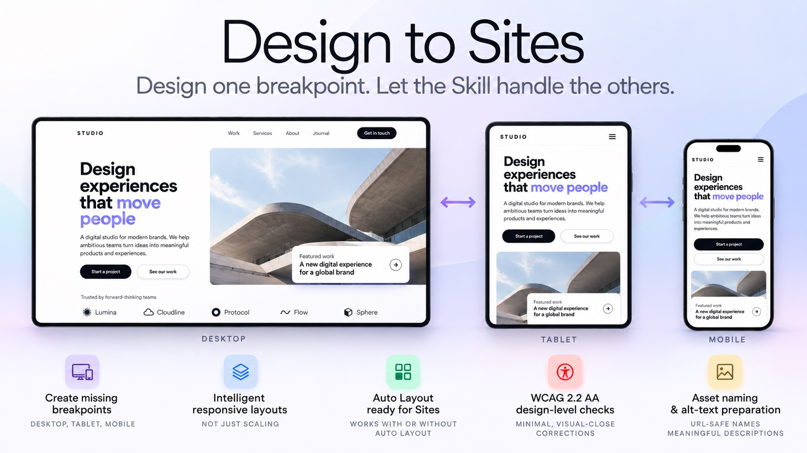

# Design to Sites

A Figma Skill that converts an existing Figma Design into a responsive, Sites-ready layout.

**You don't need to design every breakpoint yourself.** Give Design to Sites a Desktop, Tablet or Mobile design and it will adapt the design for the missing breakpoints while preserving the original visual language, content and hierarchy.

**Desktop only → Desktop + Tablet + Mobile**  
**Tablet only → Desktop + Tablet + Mobile**  
**Mobile only → Desktop + Tablet + Mobile**

Your original design is preserved.

## What it does

Design to Sites can:

- **Create the responsive breakpoints you haven't designed**
- Convert a Desktop, Tablet or Mobile design into a responsive Sites-ready layout
- Adapt layouts intelligently rather than simply scaling them
- Detect whether the source uses Auto Layout
- Reconstruct layouts using Auto Layout when it is missing or incomplete
- Apply appropriate Fill, Hug, fixed sizing, wrapping and responsive behaviour
- Preserve the original visual design, content and hierarchy
- Preserve and reuse existing components where appropriate
- Create URL-safe, semantic names for image assets
- Prepare meaningful alt-text descriptions for images
- Perform design-level accessibility checks against WCAG 2.2 AA
- Automatically correct suitable accessibility issues with minimal visual change
- Preserve the original source design

## Get the Skill

**Design to Sites is available directly from Figma Community:**

https://www.figma.com/community/skill/143297

Open the Skill in Figma Community and select **Try in...** to use it with Figma Agent.

## How to use

Open or select the Figma Design you want to convert and run **Design to Sites** using Figma Agent.

The Skill analyses the source design, its structure and any existing responsive layouts before beginning the conversion.

It can work in either direction:

**Desktop → Tablet + Mobile**

**Tablet → Desktop + Mobile**

**Mobile → Tablet + Desktop**

When adapting between form factors, the Skill preserves the existing design system, hierarchy and visual language rather than simply enlarging or shrinking the layout.

If a major design decision cannot reasonably be inferred from the source, the Skill asks before making a substantial design change.

## Auto Layout

The source does **not** need to already use Auto Layout.

Design to Sites checks whether Auto Layout is fully implemented, partially implemented, missing or mixed with absolute positioning.

Where necessary, the Skill reconstructs the converted layout using responsive Auto Layout relationships while preserving the visual intent of the original.

**The original source design is not modified.**

## Responsive conversion

The converted design targets three responsive layouts:

- **Desktop**
- **Tablet**
- **Mobile**

The Skill adapts layout behaviour rather than simply scaling the original design.

This can include changes to:

- Navigation
- Content columns and grids
- Wrapping
- Spacing and alignment
- Image behaviour
- Section sizing
- Content flow

For example, full desktop navigation may become a hamburger menu on Mobile.

## Accessibility

Design to Sites performs design-level checks against **WCAG 2.2 Level AA** where those checks can reasonably be determined from the Figma design.

Before conversion, the Skill asks:

> **Accessibility check**
>
> Design to Sites includes WCAG 2.2 AA design-level checks. Accessibility corrections may make **minimal adjustments** to colours, contrast, sizing or spacing. Changes will stay as close as possible to the original design while meeting accessibility requirements.
>
> **Continue with automatic accessibility corrections?**

When enabled, the Skill makes the **smallest adjustment necessary** to address applicable accessibility issues while preserving the original design intent.

If meeting a requirement would cause a substantial visual change, the Skill does not apply it automatically and asks the user first.

Checks may include:

- Text and UI colour contrast
- Readability
- Touch/click target sizing
- Content hierarchy
- Information communicated by colour
- Responsive accessibility issues
- Image naming and alt-text preparation

Design to Sites does **not** claim that the resulting website is WCAG compliant.

Some accessibility requirements can only be tested on the functioning Site, including keyboard navigation, screen-reader behaviour, focus order and runtime semantics.

## Image assets and Alt Text

Image assets are given meaningful, URL-safe names wherever possible.

For example:

`Hero Image` → `hero-image`

`Product Screenshot 01` → `product-screenshot-01`

Asset names use lowercase characters and hyphens, with no spaces or unnecessary special characters.

The Skill also prepares meaningful alt-text descriptions for relevant images. Decorative images are identified as decorative rather than given unnecessary descriptive alt text.

> **Important: Alt text must still be checked and applied in Figma Sites where required before publishing.**

Accessibility properties available in Figma Sites are not necessarily available in Figma Design. Asset naming and prepared descriptions assist the Sites handoff but do not replace the final accessibility check.

## After conversion

Review the converted design and move it into Figma Sites.

A short Sites-specific finishing pass may still be required for:

- Responsive breakpoint behaviour
- Mobile navigation
- Interactions and links
- Accessibility properties
- **Alt text**
- Publishing warnings

Always preview Desktop, Tablet and Mobile layouts before publishing.

## Limitations

Design to Sites prepares and adapts designs for Figma Sites, but it does not guarantee a completely finished website.

Some behaviour and accessibility properties are specific to Figma Sites and must be configured or verified after conversion.

The quality of responsive adaptation also depends on how much design intent can be inferred from the source. When a significant responsive design decision cannot be safely inferred, the Skill asks rather than inventing one.

## Source

This repository contains the source instructions for **Design to Sites**.

For normal use, install or run the published version from Figma Community:

https://www.figma.com/community/skill/143297

## Legacy MCP version

The original ChatGPT/MCP version of this Skill is retained under `/legacy-mcp` for reference.

**The MCP version is outdated and is no longer recommended for normal use.**

The Figma-native version runs directly within Figma and is now the primary version of Design to Sites.
